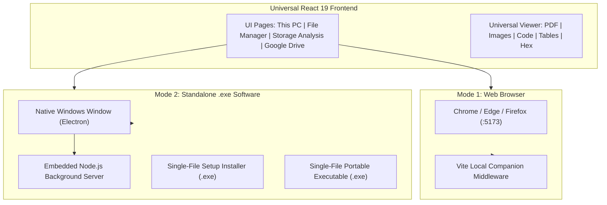

<div align="center">

# Storage Manager 🚀

### Next-Generation Local Storage Analyzer, Windows File Explorer & Cloud Backup

[](https://react.dev/)
[](https://www.typescriptlang.org/)
[](https://vitejs.dev/)
[](https://www.electronjs.org/)
[](https://tailwindcss.com/)
[](https://github.com/aniketdubeyrock/Storage-Manager)
[](LICENSE)

<br />

<p align="center">
  <strong>A desktop-grade storage intelligence utility combining the raw performance of WinDirStat and WizTree with the modern aesthetics of Linear and Windows 11.</strong>
</p>

<p align="center">
  <a href="#-key-features">Key Features</a> •
  <a href="#-desktop-exe--web-dual-mode">Desktop & Web</a> •
  <a href="#-architecture">Architecture</a> •
  <a href="#-comparisons">Comparisons</a> •
  <a href="#-quick-start">Quick Start</a> •
  <a href="#-ai-roadmap">AI Roadmap</a>
</p>


</div>

---

## 🌟 Overview

**Storage Manager** is a modern disk storage analyzer, file manager, and cloud backup software designed for high-performance directory analysis, space reclamation, and seamless file management.

Built with **React 19**, **TypeScript**, **Tailwind CSS v4**, and **Electron**, Storage Manager bridges the gap between web applications and native desktop software. It can be run directly inside any browser or compiled into a **single standalone Windows `.exe` installer or portable software**.

---

## ✨ Key Features

### 💻 1. "This PC" / Windows File Explorer
- **Physical Drive Discovery**: Automatically detects all local disk partitions (`C:`, `D:`, etc.) and removable USB drives with volume labels and drive geometry.
- **Visual Capacity Gauges**: Real-time capacity progress bars (normal blue, emergency red when $>90\%$ capacity) showing free and total space.
- **Quick Folders**: Direct one-click access to Windows core folders (*Downloads*, *Desktop*, *Documents*, *Pictures*, *Videos*, *Music*) with item counts.
- **Authentic Double-Click Navigation**: Double-clicking any drive or folder instantly opens and browses it inside the File Manager, mirroring Windows File Explorer.
- **Address & Breadcrumb Bar**: Path navigation with persistent `This PC` anchor (`This PC > Local Disk (C:) > Users > ...`).

---

### ⚡ 2. Two-Tier Progressive Sizing Engine
- **Instant Shallow Discovery (< 50ms)**: Reads and paints top-level files and folders immediately without blocking the UI thread.
- **Background Asynchronous Traversal**: Computes deep subfolder byte totals one-by-one in the background with `Calculating...` status badges, dynamically updating overall storage metrics as folders resolve.
- **Zero Freeze UX**: Traverses hundreds of thousands of files smoothly using cooperatively scheduled batch yields.

---

### 👁️ 3. Universal Multi-Mode File Viewer
A built-in viewer that automatically detects file types and offers a top toolbar mode switcher:

| Mode | Format Support | Capabilities |
| :--- | :--- | :--- |
| 🖼️ **Image Viewer** | `.jpg`, `.png`, `.webp`, `.svg`, `.gif`, `.ico`, `.bmp`, `.avif` | Zoom In/Out, 100% Reset, 90° Clockwise Rotation, pixel dimensions badge, checkerboard transparency background. |
| 📄 **PDF Reader** | `.pdf` | Native in-browser PDF viewer with paging, zoom, print, search, and new-tab button. |
| 📊 **Data Table** | `.csv`, `.tsv` | Formatted interactive data table with sticky headers, row numbering, and real-time text filter. |
| 📝 **Markdown Reader** | `.md`, `.markdown` | Rendered markdown preview (headers, lists, tables, code blocks) + 1-click source copying. |
| 💻 **Code & Text Editor** | `.txt`, `.json`, `.js`, `.ts`, `.py`, `.html`, `.css`, `.sql`, `.log`, `.yaml` | Line numbers, Word-Wrap toggle, in-file search, syntax copy, and **Prettify JSON** button. |
| 📑 **Office Documents** | `.docx`, `.xlsx`, `.pptx` | Extracts and displays readable Word document text directly in the browser via JSZip + 1-click desktop app opener. |
| 🎥 **Video Player** | `.mp4`, `.webm`, `.mov`, `.mkv` | HTML5 video player with playback speed selector (`0.5x`, `1.0x`, `1.25x`, `1.5x`, `2.0x`). |
| 🎵 **Audio Player** | `.mp3`, `.wav`, `.ogg`, `.flac`, `.m4a` | Player with seekable timeline scrubber and animated soundwave graphic. |
| 🔍 **Hex Inspector** | **ANY file / binary** (`.exe`, `.dll`, `.bin`, `.dat`, `.zip`) | Memory Offset (`00000000`) \| 16-byte Hex Dump (`4D 5A 90...`) \| Decoded ASCII characters side-by-side. |
| 🖥️ **System App Opener** | All formats | One-click launch in your computer's default application (Word, Excel, VLC, Photos, Notepad, VS Code). |

> [!NOTE]
> **No file hits a dead end.** Unknown or binary files automatically open in the **Hex Inspector**, guaranteeing every file on the system can be inspected.

---

### ☁️ 4. Google Drive Cloud Integration
- **Direct Cloud Upload**: Upload single files, selected batches, largest storage-hogging files, or ZIP archives straight to Google Drive.
- **Dedicated Cloud Folder**: Automatically organizes all uploaded files into a clean `"Storage Manager"` folder in Google Drive root.
- **Real-Time Telemetry**: Live transfer speed (`MB/s` / `KB/s`), volume progress (`X of Y MB`), dynamic percentage bar, countdown ETA, and Pause/Resume/Cancel/Retry controls.
- **Cloud File Deletion**: Delete uploaded files from Google Drive directly from the UI with live quota reconciliation.
- **CORS-Compliant Multipart & Resumable Uploads**: Uses Google REST Multipart protocol ($\le 25\text{ MB}$) and chunked resumable upload ($> 25\text{ MB}$).

---

### 🗑️ 5. Recoverable Trash & Deletion Safeguards
- **Application Trash**: Safely trashes files with original path restoration, IDB byte recovery cache, and permanent deletion option.
- **Root Drive Protection**: Strict safeguard prohibiting deletion of physical drive roots (`C:\`, `D:\`) or system directories.

---

### 👯 6. Duplicate Finder
- Multi-phase candidate clustering by exact byte size.
- Cryptographic SHA-256 streaming hash verification to detect duplicate files across different folders.

---

## 📦 Desktop (`.exe`) & Web Dual-Mode

Storage Manager runs identically as a **Web Application** and as a **Native Windows Desktop Software**:



---

## 📊 Feature Comparison

| Feature | WinDirStat | TreeSize Free | WizTree | Windows Explorer | **Storage Manager** |
| :--- | :---: | :---: | :---: | :---: | :---: |
| **Modern Responsive UI** | ❌ | ❌ | ❌ | ⚠️ | **✅ (React 19 + Tailwind)** |
| **Physical Drive Discovery (`C:`, `D:`)** | ✅ | ✅ | ✅ | ✅ | **✅ (This PC View)** |
| **Instant Progressive Sizing (< 50ms)** | ❌ | ⚠️ | ✅ | ❌ | **✅** |
| **Universal Multi-Mode Viewer** | ❌ | ❌ | ❌ | ⚠️ (Basic) | **✅ (9 Viewers + Hex)** |
| **Google Drive Cloud Backup** | ❌ | ❌ | ❌ | ❌ | **✅ (With Speed & ETA)** |
| **Single-File `.exe` Installer** | ✅ | ✅ | ✅ | Built-in | **✅ (NSIS + Portable)** |
| **Web Browser Access** | ❌ | ❌ | ❌ | ❌ | **✅ (`localhost:5173`)** |
| **Recoverable Trash System** | ❌ | ❌ | ❌ | ✅ | **✅** |
| **Dark & Light Mode** | ❌ | ⚠️ | ⚠️ | ⚠️ | **✅ (High-Contrast)** |
| **Duplicate File Finder** | ❌ | ❌ | ❌ | ❌ | **✅ (SHA-256 Hash)** |

---

## 🤖 AI Roadmap

The repository is architected for upcoming AI-driven storage management:

- 🧠 **AI Storage Assistant**: Natural language disk queries (*"Find all video files over 1GB created last month that are never opened"*).
- 🧹 **Intelligent Cleanup Suggestions**: LLM-powered disk cleanup identifying redundant cache files, obsolete log dumps, and temp folders.
- 🔍 **Semantic & Multimodal Search**: Search documents, images, and code using semantic search embeddings.
- 🏷️ **Smart Auto-Categorization**: AI tagging and organizational recommendations for cluttered folders.

---

## 🚦 Quick Start & Setup Guide

> [!TIP]
> For the complete comprehensive setup walkthrough, see the dedicated [**SETUP.md Guide**](SETUP.md).

### 🖥️ Option 1: Desktop Setup (`.exe` Software)

#### For Regular Users (No Code Needed):
1. Download **`Storage Manager Setup 1.0.0.exe`** from [Releases](https://github.com/aniketdubeyrock/Storage-Manager/releases) or the `release/` folder.
2. Double-click to install. It automatically creates **Desktop** and **Start Menu** shortcuts.
3. Launch and use Storage Manager as a native desktop application!

#### For Developers Building from Source:
```bash
# 1. Install dependencies
npm install

# 2. Run in live desktop dev mode (hot-reload)
npm run electron:dev

# 3. Build single-file Windows Installer (.exe):
npm run electron:build:nsis

# 4. Build single-file Portable executable (.exe):
npm run electron:build:portable
```
Output files are generated in `release/`:
- `release/Storage Manager Setup 1.0.0.exe` (Single-file installer wizard)
- `release/Storage Manager 1.0.0.exe` (Single-file portable app)

---

### 🌐 Option 2: Web Browser Setup

#### 1. Prerequisites
- [Node.js](https://nodejs.org/) v18.0 or newer
- Google Chrome, Microsoft Edge, Brave, or Opera

#### 2. Clone & Start
```bash
# Clone the repository
git clone https://github.com/aniketdubeyrock/Storage-Manager.git
cd Storage-Manager

# Install packages
npm install

# Start local server
npm run dev
```
Open **[http://localhost:5173](http://localhost:5173)** in your browser.

#### 3. Run Automated Tests
```bash
npm run test
```
Executes all 26 Vitest unit and integration test suites.

---

## 🛠️ Tech Stack & Architecture

- **UI Framework**: [React 19](https://react.dev/) + [TypeScript](https://www.typescriptlang.org/)
- **Build System**: [Vite 8](https://vitejs.dev/)
- **Desktop Runtime**: [Electron 45](https://www.electronjs.org/) + [electron-builder](https://www.electron.build/)
- **Styling**: [Tailwind CSS v4](https://tailwindcss.com/)
- **Icons**: [Lucide React](https://lucide.dev/)
- **State Store**: [Zustand](https://github.com/pmndrs/zustand)
- **Data Tables**: [TanStack Table v8](https://tanstack.com/table)
- **Data Visualizations**: [Recharts](https://recharts.org/)
- **Local Persistence**: [IndexedDB (`idb`)](https://github.com/jakearchibald/idb)
- **Archive Engine**: [JSZip](https://stuk.github.io/jszip/)
- **Unit & Integration Testing**: [Vitest](https://vitest.dev/)

---

## 🔒 Security & Privacy

Storage Manager operates with local-first security:
- **Local Execution**: All file indexing, hashing, and size calculations happen 100% locally on your computer.
- **Zero Third-Party Tracking**: No telemetry or user tracking.
- **Secure Google Drive OAuth**: Connects directly via official Google Identity Services (GIS) client-side OAuth 2.0 with minimal required scopes.
- **Destructive Operation Safeguards**: Critical system partitions and drive roots are guarded against accidental deletion.

---

## 📄 License

This project is licensed under the [MIT License](LICENSE).

---

<div align="center">
  <sub>Built with ❤️ by <a href="https://github.com/aniketdubeyrock">Aniket Dubey</a></sub>
</div>
